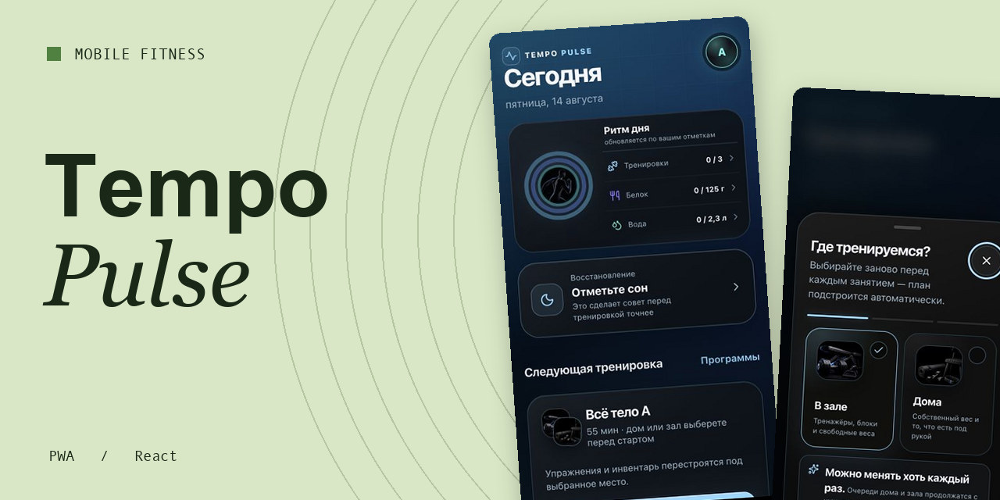
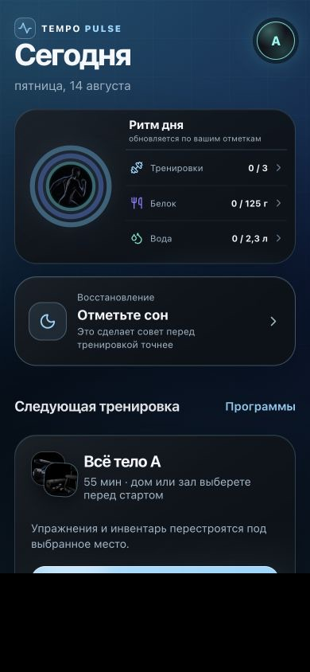
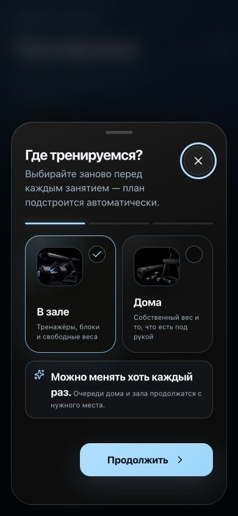
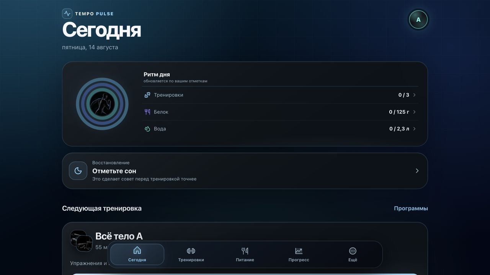

<a href="README.md"><picture><source media="(max-width: 600px)" srcset="https://raw.githubusercontent.com/mrjakeball/mrjakeball/main/assets/navigation/ru-on-compact.svg?v=3"></picture></a>
<a href="README_EN.md"><picture><source media="(max-width: 600px)" srcset="https://raw.githubusercontent.com/mrjakeball/mrjakeball/main/assets/navigation/en-off-compact.svg?v=3"></picture></a>
<a href="https://github.com/mrjakeball/portfolio"><picture><source media="(max-width: 600px)" srcset="https://raw.githubusercontent.com/mrjakeball/mrjakeball/main/assets/navigation/catalog-ru-compact.svg?v=3"></picture></a>

# TEMPO PULSE

Дневник тренировок и питания. На экране «Сегодня» собраны показатели дня, а перед тренировкой можно выбрать, где заниматься.

Опубликованная PWA · Публичная витрина приватного проекта  
React 19 · TypeScript · Dexie · WebAuthn

## Что происходит с записями

**В течение дня.** В дневнике можно вести питание, воду и сон, открывать программы тренировок и отслеживать изменения показателей.

**На устройстве.** Основные записи хранятся локально через Dexie. Это позволяет возвращаться к дневнику без постоянного подключения. Приложение поддерживает вход по PIN и через WebAuthn.

## От сводки дня к тренировке

**[Сегодня](assets/screen-home-mobile.jpg)** · Вверху виден прогресс по дневным целям. Ниже расположена карточка следующей тренировки.

**[Условия занятия](assets/screen-workout-mobile.jpg)** · Перед началом программа предлагает выбрать место тренировки. На снимке видно этот шаг до перехода к упражнениям.

Развернуть галерею

[Примечание о проекте](NOTICE.md) · [Профиль](https://github.com/mrjakeball) · [Каталог проектов](https://github.com/mrjakeball/portfolio)
