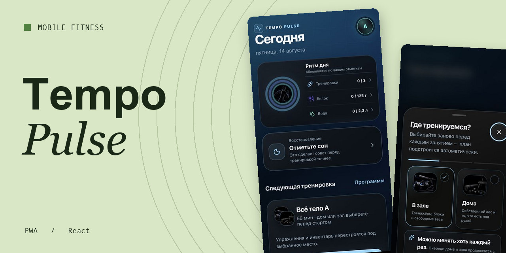
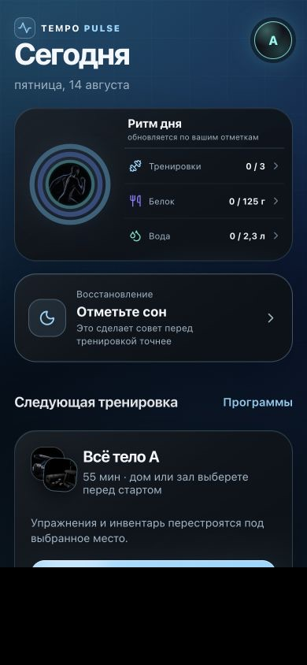
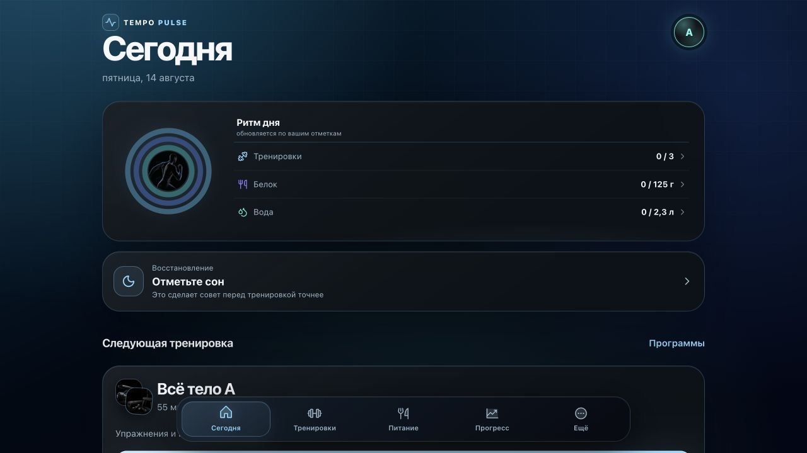

# TEMPO PULSE

A training and nutrition diary. The Today screen brings daily entries together, and the workout flow starts by asking where you plan to exercise.

Published PWA · Public showcase of a private project  
React 19 · TypeScript · Dexie · WebAuthn

## Where the entries live

**Daily use.** Log meals, water and sleep, open a workout programme and review progress.

**On the device.** Dexie manages local records so the diary can be revisited without a continuous connection. The app supports a PIN and device sign-in through WebAuthn.

## From the daily overview to a workout

**[Today](assets/screen-home-mobile.jpg)** · Daily goals sit at the top of the mobile view, with the upcoming workout below.

**[Workout setup](assets/screen-workout-mobile.jpg)** · Before the session starts, the app asks where the user will train. The screenshot captures this choice before the exercises begin.

View the gallery

[Project notice](NOTICE.md) · [Profile](https://github.com/mrjakeball/mrjakeball/blob/main/README_EN.md) · [Project catalogue](https://github.com/mrjakeball/portfolio/blob/main/README_EN.md)
